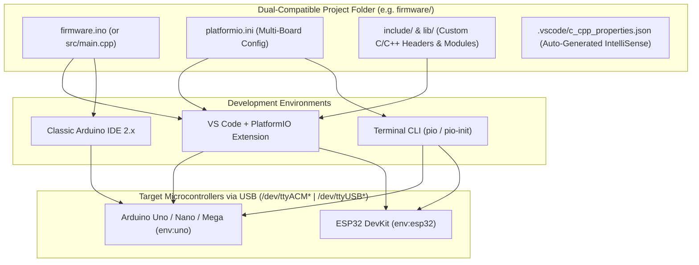

# PlatformIO + VS Code + Arduino IDE Complete Setup & Architecture Guide

> **Purpose of this Document**: This guide documents the complete embedded development environment configured on this machine (**Ubuntu 24.04 LTS**). It is structured both as a practical reference manual for you and as a rich context document that you can feed to any LLM so it understands your exact system architecture, helper scripts, file paths, compiler toolchains, and workflow.

---

## 1. System & Environment Profile (LLM Context Block)

- **OS**: Ubuntu 24.04.5 LTS (Noble Numbat) (`x86_64`)
- **User & Hardware Groups**: `sangelojas` (member of `dialout` and `plugdev` for non-root USB serial/debugger access)
- **VS Code Binary**: `/snap/bin/code`
- **VS Code User Settings**: `/home/sangelojas/.config/Code/User/settings.json`
- **Relevant Installed VS Code Extensions**:
  - `platformio.platformio-ide` (PlatformIO IDE GUI & task runner)
  - `ms-vscode.cpptools` & `ms-vscode.cpptools-extension-pack` (C/C++ IntelliSense, debugging, code navigation)
- **PlatformIO Core Installation**:
  - Isolated Virtual Environment: `/home/sangelojas/.platformio/penv` (Python 3.12)
  - PlatformIO Core Version: `6.2.0`
  - CLI Symlinks in `PATH` (`/home/sangelojas/.local/bin`):
    - `/home/sangelojas/.local/bin/pio` -> `~/.platformio/penv/bin/pio`
    - `/home/sangelojas/.local/bin/platformio` -> `~/.platformio/penv/bin/platformio`
    - `/home/sangelojas/.local/bin/piodebuggdb` -> `~/.platformio/penv/bin/piodebuggdb`
- **Pre-installed PlatformIO Toolchains (`~/.platformio/packages` & `~/.platformio/platforms`)**:
  - `atmelavr` (`5.3.0`)
  - `framework-arduino-avr` (`5.4.0`)
  - `toolchain-atmelavr` (`1.70300.191015` / `avr-gcc 7.3.0`)
  - `tool-scons` (`4.41101.0`)
- **Classic Arduino IDE Coexistence**:
  - Config directories: `/home/sangelojas/.arduino15` and `/home/sangelojas/.arduinoIDE`
  - Default Arduino Sketchbook: `/home/sangelojas/Arduino` (libraries shared via `lib_extra_dirs = ~/Arduino/libraries`)

---

## 2. Architecture Overview: How PlatformIO, VS Code, and Arduino IDE Work Together



### Why This Setup Is Dual-Compatible
Normally, the **Arduino IDE** requires a `<folder>/<folder>.ino` file in the root directory, whereas **PlatformIO** defaults to `<folder>/src/main.cpp`.

To allow **both** tools to open and compile the exact same folder without moving files:
1. `platformio.ini` sets `src_dir = .` inside the `[platformio]` section when an `.ino` file is present in the project root.
2. PlatformIO's build system automatically preprocesses `.ino` files into valid C++ (`.ino.cpp`) during compilation while preserving compatibility with the classic Arduino IDE.
3. `lib_extra_dirs = ~/Arduino/libraries` is configured under `[env]` so any library installed via the Arduino IDE Library Manager is automatically visible to PlatformIO as well.

---

## 3. What Was Configured on This Machine

### 3.1 USB Hardware Permissions & Ubuntu Serial Fix (`pio-fix-usb`)
On Ubuntu 24.04, two OS-level issues normally block microcontroller serial ports:
1. **Missing `udev` rules**: Installed official PlatformIO rules from `~/.platformio/99-platformio-udev.rules` to `/etc/udev/rules.d/99-platformio-udev.rules` and reloaded `udevadm`. This grants non-root USB access to Arduino boards, ESP32s, STM32s, RP2040s, and hardware debug probes (ST-Link, J-Link, CMSIS-DAP).
2. **The `brltty` Conflict**: Ubuntu pre-installs `brltty` (a Braille display daemon) which aggressively claims `CH340` and `CP210x` USB-to-UART chips used on Arduino clones and ESP32 boards, causing `/dev/ttyUSB0` to immediately disconnect upon plug-in. `brltty` was stopped and removed via `/home/sangelojas/.local/bin/pio-fix-usb`.

### 3.2 VS Code Settings (`/home/sangelojas/.config/Code/User/settings.json`)
The following settings were added to keep VS Code fast and conflict-free:
```json
{
    "files.watcherExclude": {
        "**/.pio/**": true
    },
    "search.exclude": {
        "**/.pio": true
    },
    "files.associations": {
        "*.ino": "cpp",
        "*.pde": "cpp"
    },
    "cmake.configureOnOpen": false
}
```
- **`"*.ino": "cpp"`**: Tells the Microsoft C/C++ extension (`ms-vscode.cpptools`) to treat `.ino` sketch files as C++, enabling full autocomplete, go-to-definition, and inline error checking.
- **`"**/.pio/**": true`**: Prevents VS Code from indexing thousands of compiled object files and downloaded SDKs inside `.pio/`.
- **`"cmake.configureOnOpen": false`**: Prevents the VS Code CMake Tools extension from hijacking PlatformIO projects when ESP32/ESP-IDF libraries contain internal `CMakeLists.txt` files.

---

## 4. Custom Helper Scripts Installed in `~/.local/bin`

### 4.1 `pio-init` (`/home/sangelojas/.local/bin/pio-init`)
Initializes any new or existing folder in either **Professional Mode (`--pro`)** or **Quick Sketch Mode** and generates `.vscode/c_cpp_properties.json` for instant C/C++ IntelliSense.

**Usage**:
```bash
# 1. Professional Mode (Industry-standard multi-file C/C++ layout: src/main.cpp, lib/, include/, test/)
pio-init --pro . uno
pio-init --pro ~/Documents/code/projects/my-esp32-node esp32

# 2. Quick Sketch Mode (Single-file <FolderName>.ino compatible with both Arduino IDE & VS Code)
pio-init ~/Arduino/MyQuickPractice uno
```

**What `pio-init` generates**:
1. **`<FolderName>.ino`** (if no `.ino` or `src/` exists yet) with `#include <Arduino.h>`, `setup()`, and `loop()`.
2. **`include/` and `lib/`** directories for modular C/C++ headers and libraries.
3. **`.gitignore`** ignoring `.pio/` build artifacts and machine-specific `.vscode/c_cpp_properties.json` paths.
4. **`platformio.ini`** with 5 pre-configured hardware environments:
   - `[env:uno]` — Arduino Uno (`ATmega328P`)
   - `[env:nanoatmega328]` — Arduino Nano (New Bootloader)
   - `[env:nanoatmega328old]` — Arduino Nano (Old Bootloader / Chinese CH340 clones)
   - `[env:megaatmega2560]` — Arduino Mega 2560
   - `[env:esp32]` — ESP32 DevKit V1 (`esp32dev`)
5. **`.vscode/c_cpp_properties.json`** via `pio project init --ide vscode --environment <env>` so VS Code knows the exact compiler include paths (`Arduino.h`, AVR/ESP32 registers, etc.).

### 4.2 `pio-fix-usb` (`/home/sangelojas/.local/bin/pio-fix-usb`)
Re-applies `/etc/udev/rules.d/99-platformio-udev.rules`, reloads `udevadm`, and ensures `brltty` is removed if an OS update ever reinstalls it.

---

## 5. Anatomy of `platformio.ini`

Every PlatformIO project is controlled by `platformio.ini` in the project root:

```ini
[platformio]
default_envs = uno
src_dir = .

[env]
framework = arduino
lib_extra_dirs = ~/Arduino/libraries
monitor_filters = direct, time

; --- Arduino Uno ---
[env:uno]
platform = atmelavr
board = uno
monitor_speed = 9600

; --- ESP32 DevKit V1 / NodeMCU-32S ---
[env:esp32]
platform = espressif32
board = esp32dev
monitor_speed = 115200
```

### Key Configuration Options to Know
- **`default_envs`**: Which board builds/uploads by default when you click Build (`✓`) or run `pio run`. Change `default_envs = uno` to `default_envs = esp32` when switching to ESP32!
- **`monitor_speed`**: The baud rate for the Serial Monitor. Must match `Serial.begin(baud)` in your code (`9600` is typical for basic Arduino examples; `115200` is standard for ESP32).
- **`upload_port`** *(optional)*: PlatformIO auto-detects `/dev/ttyACM0` or `/dev/ttyUSB0`. If you have multiple boards plugged in at once, you can lock a specific port under an environment:
  ```ini
  upload_port = /dev/ttyACM0
  monitor_port = /dev/ttyACM0
  ```
- **`lib_deps`** *(optional)*: Installs third-party libraries automatically per-project from the PlatformIO Registry without polluting global folders:
  ```ini
  lib_deps =
      adafruit/Adafruit Unified Sensor @ ^1.1.14
      bblanchon/ArduinoJson @ ^7.0.0
  ```

---

## 6. Daily Workflow Cheat Sheet (GUI & Terminal)

### 6.1 Opening a Project Correctly in VS Code
> **Important Rule**: Always open the folder that directly contains `platformio.ini` (for example, `code ~/Documents/code/projects/modular-sensor-telemetry/firmware`), OR use **Alien Icon (Left Sidebar) -> Quick Access -> PIO Home -> Open -> Open Project** to select `firmware/`.
> If VS Code is opened at a parent folder that does not contain `platformio.ini` at its root, the PlatformIO bottom toolbar and C++ `Arduino.h` IntelliSense won't activate automatically.

### 6.2 VS Code Bottom Status Bar Controls vs. Terminal CLI

| Task | VS Code Status Bar (Bottom) | Terminal Command (inside project folder) |
| :--- | :--- | :--- |
| **Compile / Build** | **`✓`** (Checkmark icon) | `pio run` |
| **Upload Firmware to Board** | **`→`** (Right arrow icon) | `pio run -t upload` |
| **Open Serial Monitor** | **`🔌`** (Plug icon) | `pio device monitor` *(Exit with `Ctrl+C`)* |
| **Upload + Monitor (1-step)** | *Sidebar -> Project Tasks -> Upload and Monitor* | `pio run -t upload -t monitor` |
| **Clean Build Files** | **`🗑️`** (Trashcan icon) | `pio run -t clean` |
| **Switch Active Board** | Click **`env:uno`** in bottom bar | `pio run -e esp32` (or edit `default_envs`) |
| **Refresh C++ IntelliSense** | *Command Palette -> PlatformIO: Rebuild IntelliSense Index* | `pio project init --ide vscode` |
| **List Connected USB Boards** | *Sidebar -> PIO Home -> Devices* | `pio device list` |

### 6.3 Multi-Project Repository Commands (Running from Repo Root with `-d`)

When your terminal is at the repository root (`modular-sensor-telemetry/`), use `-d <project-dir>` to target either the main telemetry firmware or any side component experiment in `arduino_practice/Arduino/Components/`:

```bash
# Main pipeline firmware (firmware/)
pio run -d firmware -e uno
pio run -d firmware -e uno -t upload -t monitor

# Standalone component experiment (e.g., RainDropModule or UltrasonicSensor)
pio run -d arduino_practice/Arduino/Components/RainDropModule/RainModule -e uno -t upload -t monitor
pio run -d arduino_practice/Arduino/Components/UltrasonicSensor/UltraSonicSensor -e uno -t upload -t monitor

# Initialize a brand-new component side project
mkdir -p arduino_practice/Arduino/Components/NewSensor
pio-init arduino_practice/Arduino/Components/NewSensor uno
```

---

## 7. Integrating Custom C Code (e.g., `proximity.c` / `proximity.h`) into Arduino/ESP32

Because Arduino sketches (`.ino`) are compiled as **C++** (`avr-g++` / `xtensa-esp32-elf-g++`), while pure `.c` files are compiled as **C** (`avr-gcc`), follow these two best practices when sharing C modules (like your `c-prac/distance-classifier/proximity.c` and `proximity.h`) with your `firmware/` project:

1. **Where to put the files**:
   - Place shared `.h` and `.c` (or `.cpp`) files inside `firmware/lib/proximity/` (e.g., `firmware/lib/proximity/proximity.h` and `firmware/lib/proximity/proximity.c`) or directly inside `firmware/` alongside `firmware.ino`.
2. **Add `extern "C"` guards in your `.h` header file**:
   So C++ (`firmware.ino`) can call functions compiled in pure C (`proximity.c`) without C++ name-mangling linker errors, wrap declarations in `proximity.h` like this:
   ```c
   #ifndef PROXIMITY_H
   #define PROXIMITY_H

   #ifdef __cplusplus
   extern "C" {
   #endif

   // Your existing structs, enums, and function declarations here

   #ifdef __cplusplus
   }
   #endif

   #endif // PROXIMITY_H
   ```
   Then simply `#include "proximity.h"` at the top of `firmware.ino`!

---

## 8. Troubleshooting Reference

| Symptom | Cause | Fix |
| :--- | :--- | :--- |
| `#include <Arduino.h>` has a red squiggly line in VS Code | VS Code is opened at a parent folder above `platformio.ini`, or IntelliSense index hasn't refreshed | Open the `firmware/` folder directly (`code firmware`) or run `pio project init --ide vscode` inside `firmware/` and reload window (`Ctrl+Shift+P` -> `Developer: Reload Window`). |
| `avrdude: stk500_recv(): programmer is not responding` on Arduino Nano | Many Nano clones use the older ATmega328P bootloader | Switch environment from `nanoatmega328` to `nanoatmega328old` (`pio run -e nanoatmega328old -t upload`). |
| Serial port `/dev/ttyACM0` or `/dev/ttyUSB0` is busy during upload | Serial Monitor is still open in another terminal or Arduino IDE | Close the Serial Monitor (`Ctrl+C`) before uploading, or use `pio run -t upload -t monitor` which handles closing/reopening automatically. |
| Garbage characters in Serial Monitor | Mismatch between `Serial.begin(...)` in code and `monitor_speed` in `platformio.ini` | Ensure both match (`9600` for Uno default in `platformio.ini`, or `115200` for ESP32). |
| ESP32 fails to enter bootloader on upload (`Connecting........_____`) | Some ESP32 boards require holding the `BOOT` button during upload | Hold down the physical `BOOT` button on the ESP32 when `Connecting...` appears, then release once uploading starts. |
